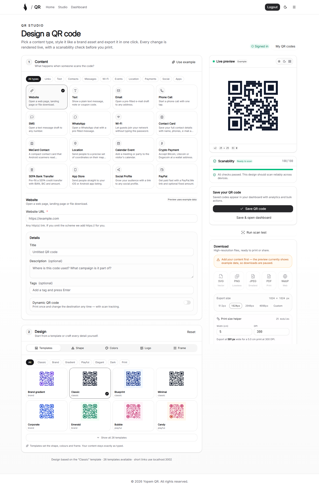
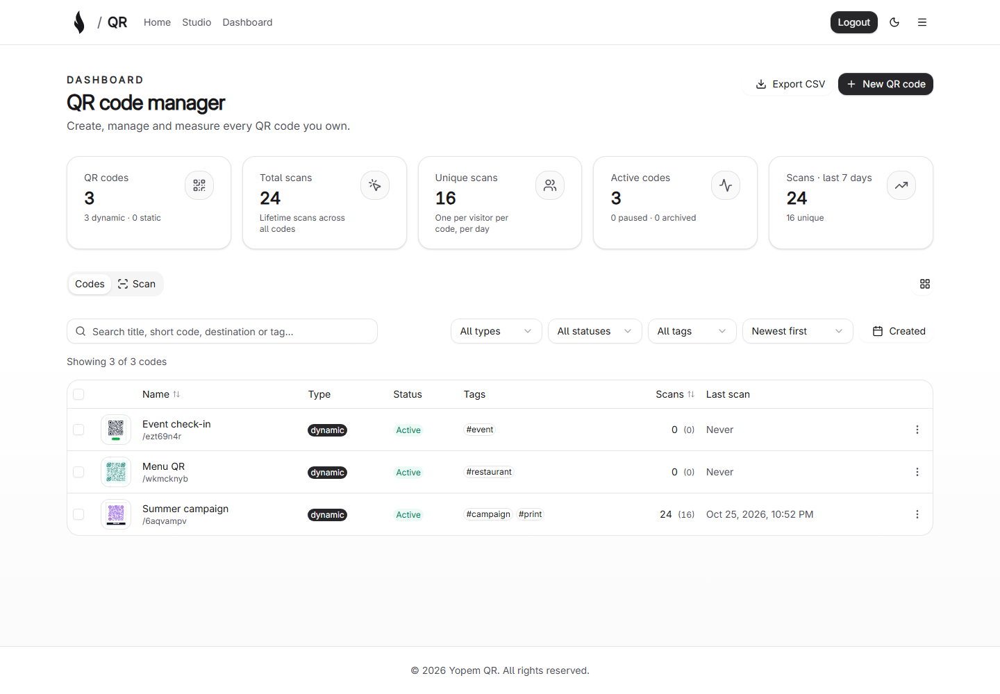
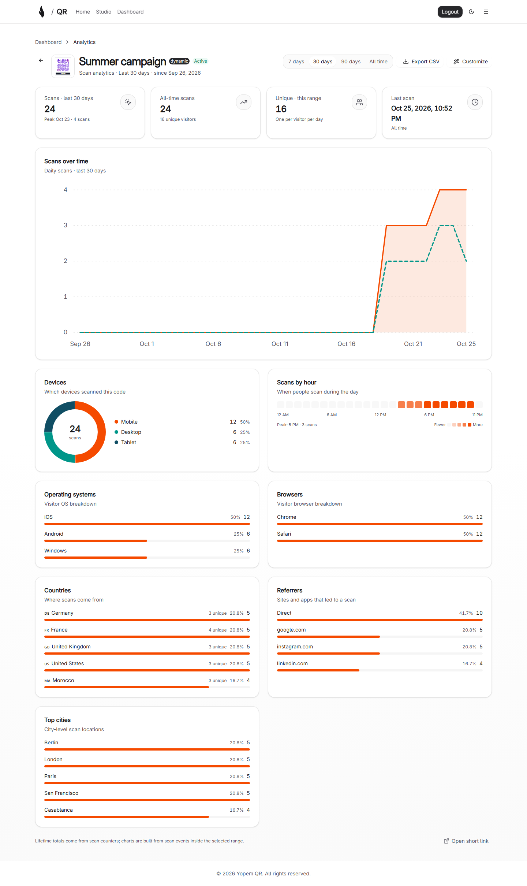
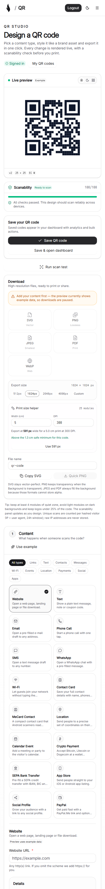

# Yopem QR

An open-source QR code platform with a full design studio, 16 content types, dynamic short links
with scan analytics, and a camera scanner. Built with SvelteKit 2, Svelte 5, Tailwind CSS v4,
Drizzle ORM and PostgreSQL.

 <br />

## Screenshots

| QR Studio | Dashboard |
| --- | --- |
|  |  |

| Analytics | Mobile studio |
| --- | --- |
|  |  |

## Features

### QR Studio

A two-pane design studio with live, client-side preview and print-ready export.

- **10 module shapes** — square, rounded, dots, diamond, star, cross, leaf, classy, hexagon,
  squircle.
- **6 eye frame + 5 eye ball styles** — square, rounded, circle, leaf, octagon, squircle frames;
  square, rounded, dots, leaf, squircle balls.
- **Colour freedom** — solid or linear/radial gradient foregrounds, solid/gradient/transparent
  backgrounds, optional eye colour overrides.
- **Logo embedding** — data-URL logo, size/padding/radius controls, automatic module clearing behind
  the logo, and an error-correction recommendation when a logo is added.
- **8 frame styles** — borderless card, rounded, bottom banner, top banner, pill badge, ticket,
  double border, and none — with custom captions, colours and font sizes.
- **26 curated templates** to start from, covering classic, brand, playful, elegant, dark, gradient
  and print categories.
- **Scanability guardrails** — contrast checks, inverted-colour warning, quiet-zone warning, logo
  size warnings and a print-size calculator (physical cm + DPI to required pixels).
- **Exports** — SVG (vector), PNG (any size, transparent option), JPEG, PDF, WebP, plus "copy SVG"
  for design tools.

### 16 content types

Links, plain text, email, phone, SMS, WhatsApp, WiFi, vCard, MeCard, location (geo), calendar
events, crypto payments, SEPA payments (EPC069-12), app store links, social profiles and PayPal.
Each type has a dedicated form, validation, and a payload parser used by the scanner.

### Dynamic QR codes

Turn any URL-like content type into a dynamic short link:

- Edit the destination after printing.
- Pause, archive, or set an expiry date.
- Password-protect a code with a signed 30-minute unlock cookie.
- Organise codes with tags, search and filters.
- Duplicate, bulk archive/pause/activate/delete and export to CSV.
- Every dynamic code gets a short link (`/{shortCode}`) that records the scan before redirecting.

### Scan analytics

A dedicated analytics page per QR code with a 7/30/90-day/all range selector:

- Total scans, unique scans, last scan, range totals.
- Scans over time (area chart with unique overlay).
- Device type, operating system and browser breakdowns.
- Countries, cities, referrers and an hour-of-day heatmap.
- CSV export built from the same data.
- Privacy-first: raw IPs are never stored — only salted hashes, with a 24-hour uniqueness window.

### Scanner

- Live camera scanning via `getUserMedia` with torch/multi-camera controls when supported.
- Upload, drag & drop, or paste a screenshot.
- `BarcodeDetector` fast path with a `jsQR` fallback.
- Structured result cards for WiFi, vCards, MeCards, email, SMS, geo, events and URLs.
- On-device scan history; no images leave the browser.

### REST API

Programmatic access is available for teams that generate codes in bulk:

- `POST /api/keys` creates an API key (the secret is shown once); `GET /api/keys` lists prefixes, `DELETE /api/keys/[id]` revokes.
- `POST /api/v1/qr` (bearer key) creates a static or dynamic QR code with a full design object; `GET /api/v1/qr` lists with `status`/`type`/`search`/`limit`/`offset`.
- Session-authenticated app APIs: `PATCH/DELETE /api/qr/[id]`, `POST /api/qr/bulk` (activate/pause/archive/duplicate/delete), `GET /api/qr/export?format=csv`.

### Architecture

```
src/
  lib/qr/                 # Isomorphic QR engine (no DOM / Node APIs)
    matrix.ts             # Payload -> module matrix (error correction + masking via qrcode)
    geometry.ts           # Dot, eye and frame path geometry (SVG / PDF ready)
    render.ts             # renderQrSvg(): full design -> standalone SVG
    scanability.ts        # Contrast, logo and density heuristics
    export.ts             # SVG -> PNG/JPEG/WebP/PDF (browser)
    content/              # 16 content codecs + registry + tests
    templates.ts          # Curated design presets
  lib/components/studio/  # Studio UI (type picker, design controls, export panel)
  lib/components/analytics/ # Dependency-free SVG charts
  lib/server/             # Drizzle schema, QR service, analytics, auth issuer
  routes/                 # /studio, /dashboard, /dashboard/analytics/[id], API routes
```

The engine is dependency-light: `qrcode` provides Reed–Solomon encoding and mask selection, while
all styling, geometry, export and validation live in this repository. It runs in the browser (live
preview) and on the server (SSR showcase and OG images) from the same code.

### Tech stack

- **Runtime**: Bun
- **Framework**: SvelteKit 2 with Svelte 5 (runes)
- **Language**: TypeScript
- **UI**: Tailwind CSS v4, shadcn-svelte/bits-ui primitives, Lucide icons
- **Database**: PostgreSQL with Drizzle ORM
- **Auth**: OpenAuth (self-hosted issuer included)
- **QR**: `qrcode` encoder, `jsqr` fallback decoder

## Prerequisites

- [Bun](https://bun.sh) 1.3 or higher
- PostgreSQL database
- Git

## Installation

```bash
git clone https://github.com/yopem/qr.git
cd qr
bun install
cp .env.example .env
# edit .env (see Environment Variables)
bun run db:generate
bun run db:migrate
bun run dev
```

Open http://localhost:5173.

### Environment variables

| Variable                                                           | Required    | Description                                                    |
| ------------------------------------------------------------------ | ----------- | -------------------------------------------------------------- |
| `DATABASE_URL`                                                     | yes         | PostgreSQL connection string (Supabase pooled URLs supported). |
| `AUTH_ISSUER`                                                      | no          | OpenAuth issuer URL. Defaults to the self-hosted issuer.       |
| `SCAN_SALT`                                                        | recommended | Salt for hashed IP/visitor analytics identifiers.              |
| `UNLOCK_SECRET`                                                    | recommended | HMAC secret for password-protected QR unlock cookies.          |
| `PUBLIC_SITE_TITLE`, `PUBLIC_SITE_DESCRIPTION`, `PUBLIC_SITE_NAME` | no          | SEO/site metadata.                                             |

## Scripts

| Script                                       | Description                                                         |
| -------------------------------------------- | ------------------------------------------------------------------- |
| `bun run dev`                                | Start the Vite dev server.                                          |
| `bun run build`                              | Production build (Node adapter by default, Vercel when `VERCEL=1`). |
| `bun run preview`                            | Preview the production build on port 3002.                          |
| `bun run check`                              | Type-check with svelte-check.                                       |
| `bun test`                                   | Run unit tests (engine, content codecs, payload parser).            |
| `bun run verify:qr`                          | Render every style in headless Chrome and decode the screenshots.   |
| `bun run lint` / `bun run format:check`      | ESLint / Prettier checks.                                           |
| `bun run db:generate` / `bun run db:migrate` | Drizzle migrations.                                                 |

## Verification

Two layers keep the QR engine honest:

1. `bun test` — unit tests for encoding, geometry, design warnings, content codecs and payload
   parsing.
2. `bun run verify:qr` — renders a matrix of designs (every dot/eye/frame style, gradients, logos,
   error-correction levels), screenshots each one in headless Chrome, decodes it with `jsqr`, and
   fails if any code no longer reads back correctly. See
   [docs/verification.md](docs/verification.md).

Competitive research that informed the design system and feature set lives in
[docs/research](docs/research/).

## Deployment

```bash
VERCEL=1 bun run build   # Vercel adapter
bun run build            # Node adapter (@sveltejs/adapter-node)
```

Run `bun run db:migrate` against the production database once. Set `SCAN_SALT` and `UNLOCK_SECRET`
in the hosting environment so analytics hashes and unlock cookies are stable across deploys.

## License

AGPL-3.0-or-later — see [LICENSE.md](LICENSE.md).
